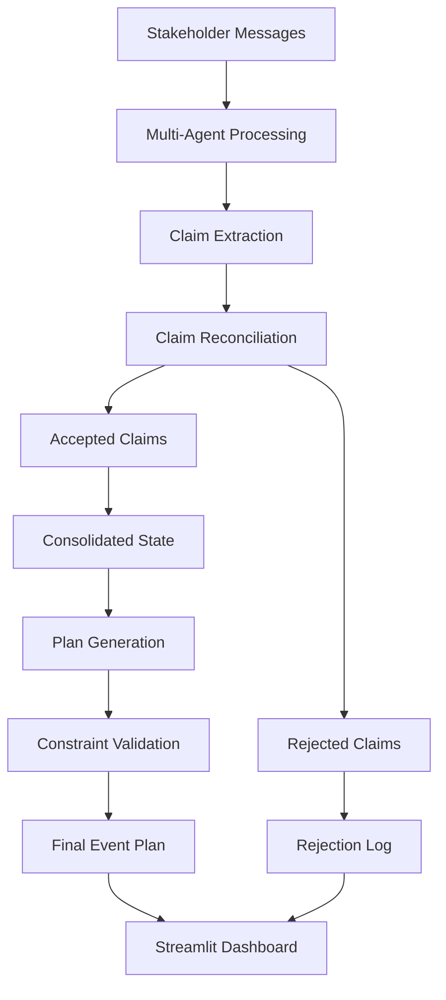
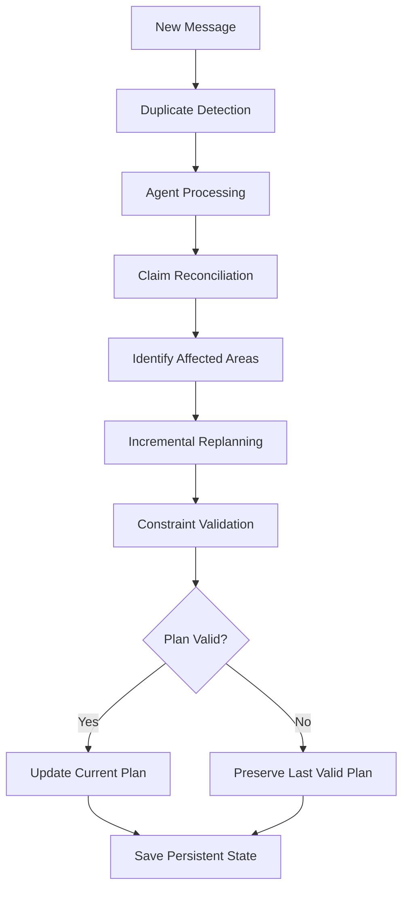

# Mind to Machine (MTM)
### Multi-Agent AI System for Intelligent Event Planning

Mind to Machine (MTM) is an AI-powered event planning system that transforms unstructured stakeholder messages into a structured, constraint-aware event plan.

Developed for a real-world hackathon planning challenge, MTM uses a multi-agent processing pipeline to extract information, reconcile conflicting claims, generate an event plan and validate operational constraints.

The system also supports incremental updates, allowing new information to be processed without unnecessarily rebuilding the entire plan.

---

## 1. Project Overview

The challenge is to plan a four-hour physical hackathon in Islamabad for:

- **150 students**
- **50 teams**
- **4 hours of event duration**

The system manages five major planning areas:

| Planning Area | Responsibilities |
|---|---|
| Venue | Capacity, availability, cost and standby generator |
| Schedule | Activities, timings and event duration |
| Food & Catering | Food quantities, pricing and delivery |
| Judging | Judge availability, allocation and honorariums |
| Budget | Approved limit, committed expenses and remaining funds |

Stakeholder messages may contain new information, duplicate submissions or conflicting claims. MTM processes these messages and maintains a consolidated event plan that reflects the latest accepted information.

## 2. Key Features

### Multi-Agent Message Processing
- Processes unstructured stakeholder messages using an LLM-powered agent pipeline.
- Extracts relevant structured claims.
- Organizes information according to planning areas.
- Maintains consolidated application state.

### Claim Reconciliation
- Identifies conflicting claims.
- Evaluates incoming information against existing claims.
- Records rejected claims and their reasons.
- Maintains traceability to original messages.

### Constraint-Aware Planning
- Generates a structured event plan.
- Evaluates venue feasibility and resource requirements.
- Checks judging capacity and scheduling constraints.
- Validates the overall event budget.
- Reports failed constraints.

### Incremental Updates
- Processes new stakeholder messages after initial planning.
- Detects duplicate messages using SHA-256 hashing.
- Identifies affected planning areas.
- Recalculates relevant planning components.
- Preserves the last valid plan when an update introduces constraint failures.

### Groq API Integration
- Uses Groq as the LLM provider.
- Connects to the configured language model.
- Captures actual provider-reported token usage.
- Records individual model calls and execution duration.

### Execution Monitoring
- Tracks successful and failed model calls.
- Displays input messages and LLM responses.
- Records accepted and rejected claims.
- Monitors prompt, completion and total tokens.
- Maintains cumulative execution statistics.

### Persistent State
- Saves claims, messages, plans and execution traces.
- Maintains application state across sessions.
- Supports JSON downloads for the final plan and complete state.

---

## 3. System Architecture

MTM follows a modular architecture separating message processing, claim reconciliation, plan generation and frontend presentation.



### Incremental Update Workflow



---

## 4. Technology Stack

| Technology | Purpose |
|---|---|
| Python | Core application development |
| Streamlit | Interactive web interface |
| Groq API | Large language model integration |
| Custom Agent Pipeline | Message processing and claim reconciliation |
| JSON | Persistent application state |
| SHA-256 | Duplicate message detection |
| Git & GitHub | Version control and collaboration |

---

## 5. Project Structure

```text
Mind-to-Machine/
│
├── app.py                  # Streamlit application
├── agent.py                # Agent orchestration
├── config.py               # LLM configuration
│
├── core/
│   ├── parser.py           # Response parsing
│   ├── planner.py          # Event plan generation
│   ├── updater.py          # Incremental updates
│   └── schema.py           # State schema
│
├── data/
│   └── messages.txt        # Initial stakeholder messages
│
├── output/
│   └── state.json          # Persistent application state
│
├── requirements.txt        # Python dependencies
├── .env                    # Environment configuration
├── .gitignore
└── README.md
```

---

## 6. Installation and Setup

### Prerequisites

Before running the application, ensure you have:

- Python 3.10 or later, compatible with project dependencies.
- pip package manager.
- Internet connection.
- Groq API key.

### Step 1: Clone the Repository

```bash
git clone YOUR_GITHUB_REPOSITORY_URL
cd Mind-to-Machine
```

Replace the repository URL with your actual GitHub repository URL.

### Step 2: Create a Virtual Environment

For Windows:

```bash
python -m venv venv
venv\Scripts\activate
```

For Linux/macOS:

```bash
python3 -m venv venv
source venv/bin/activate
```

### Step 3: Install Dependencies

```bash
pip install -r requirements.txt
```

### Step 4: Configure Groq API

1. Visit https://console.groq.com/
2. Create an account or sign in.
3. Generate an API key.
4. Create a `.env` file in the project root.
5. Add your API key using the environment variable name expected by `config.py`.

Example:

```env
GROQ_API_KEY=your_groq_api_key_here
```

Never upload your actual API key to GitHub.

### Step 5: Verify Configuration

Check `config.py` to ensure:
- The LLM backend is configured for Groq.
- The environment variable is loaded correctly.
- The selected model is supported by your Groq account.

### Step 6: Run the Application

Start the Streamlit application:

```bash
streamlit run app.py
```

Open the local application in your browser:

http://localhost:8501

---

## 7. Application Modules

The application provides four main sections.

### 01. Event Overview

Provides a consolidated view of the generated event plan.

Displays:
- Total attendees and teams.
- Event duration.
- Venue allocation.
- Food and catering details.
- Judging arrangements.
- Event schedule.
- Budget breakdown.
- Constraint validation results.

### 02. Live Updates

Allows users to submit additional stakeholder messages.

The system:
1. Checks for duplicate messages.
2. Processes new information through the agent pipeline.
3. Extracts and reconciles claims.
4. Identifies affected planning areas.
5.
